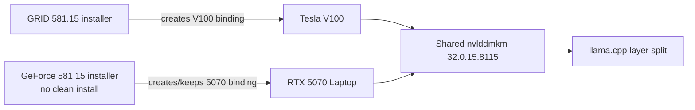

# RTX 5070 + Tesla V100 Windows Dual-GPU LLM Kit

[](LICENSE)
[](#requirements)
[](#prebuilt-runtime)
[](docs/llama-build.md)

在 Windows 下让 RTX 5070 Laptop 与 Tesla V100-SXM2-16GB 同时被 llama.cpp 使用的可复现实验套件。仓库包含驱动共存方法、GPU 监视器、便携式 llama.cpp 图形启动器、编译脚本、成功记录和排障文档。

> Tested with Windows 11, RTX 5070 Laptop 8 GB, Tesla V100-SXM2 16 GB, NVIDIA 581.15, CUDA 12.9 and llama.cpp v0.8.0.

## 项目状态

本机在 `2026-11-05 09:21` 验证过以下状态：

| GPU | Windows 状态 | 显存 | 驱动 | INF |
|---|---|---:|---:|---|
| Tesla V100-SXM2-16GB | Healthy | 16384 MiB | 581.15 | oem33.inf |
| RTX 5070 Laptop GPU | Healthy | 8151 MiB | 581.15 | oem32.inf |

llama.cpp 日志同时识别两张卡，并将一个 35B MoE GGUF 的 41/41 层分配到 CUDA0 和 CUDA1。完整脱敏记录见 [成功证据](docs/success-evidence.md)。

## 功能

- Windows 双 NVIDIA GPU 共存记录和恢复顺序
- `GPU Sentinel` WinForms 监视器：自动发现并选择核显、独显和计算卡；NVIDIA 显示利用率、显存、温度、功耗、时钟和 PCIe，Intel/AMD 等设备显示 PnP、驱动、INF、状态和问题代码
- 便携式 llama.cpp PowerShell 图形启动器：多模型选择、视觉投影、MTP、上下文、端口、GPU 顺序和 tensor split
- CUDA 12.9 + `sm_70;sm_120` 编译脚本
- 已编译 Windows x64 runtime，作为 GitHub Release 资产发布
- 成功日志摘要、驱动校验值和故障排查流程
- 默认不收集遥测，不包含模型权重、NVIDIA 驱动安装包、账号或硬件 UUID

## 它不是

- 不是 NVLink、SLI 或显存池合并。V100 的 16 GB 与 5070 的 8 GB 不会变成一个可直接分配的 24 GB 显存池。
- 不是 NVIDIA 官方支持矩阵的一部分。
- 不保证所有 V100/5070 OEM 组合都能得到相同结果。
- 不提供 NVIDIA 驱动安装包的再分发。

## 工作原理

Windows 的 NVIDIA 显卡共用同一个 `nvlddmkm` 内核服务。成功方案的关键不是同时加载两个驱动版本，而是让两张卡最终使用同一个 581.15 内核版本，同时保留两张卡各自的设备绑定。



更完整的驱动说明见 [docs/driver-coexistence.md](docs/driver-coexistence.md)。

## 快速开始

### 1. 获取已编译 runtime

从本仓库的 Releases 页面下载：

```text
llama-cuda12.9-windows-x64.zip
```

解压后让目录结构变成：

```text
runtime/
└─ bin/
   ├─ llama-server.exe
   ├─ ggml-cuda.dll
   └─ ...
```

### 2. 放入自己的 GGUF

```text
models/
└─ your-model.gguf
```

模型权重不包含在本仓库中。请自行确认模型许可证和再分发条件。

### 3. 启动

```text
start-llama.cmd
```

图形界面中：

1. 选择主模型。
2. 按检测顺序选择 `V100 优先 (0,1)` 或 `5070 优先 (1,0)`。
3. 调整 V100/5070 的 tensor split。
4. 首次建议上下文从 4096 或 8192 开始。
5. 启动后打开 `http://127.0.0.1:8080`。

### 4. 启动监视器

```text
monitor\V100Monitor.exe
```

监视器只调用系统 `nvidia-smi`、PnP API 和 Windows 事件日志，不复制 NVIDIA DLL。

点击顶部的“显卡”按钮可以勾选要同时监视的设备，例如 Intel 核显、RTX 5070 和 Tesla V100。也可用以下命令直接打开选择窗口：

```text
monitor\V100Monitor.exe --select-devices
```

## 从源码构建

### llama.cpp

要求：

- Windows 10/11 x64
- Visual Studio C++ Build Tools
- CMake 3.14+
- Ninja
- CUDA Toolkit 12.9
- NVIDIA 驱动 581.15

```powershell
.\scripts\fetch-llama-source.ps1
.\scripts\build-llama-portable.ps1 -CudaRoot 'C:\Program Files\NVIDIA GPU Computing Toolkit\CUDA\v12.9'
```

详细参数和 GPU 架构说明见 [docs/llama-build.md](docs/llama-build.md)。

### GPU Sentinel

```powershell
.\monitor\build.ps1
```

构建使用 Windows 自带 .NET Framework 4.8 C# 编译器。

## 驱动

仓库不包含 NVIDIA 安装包。保留并校验以下两个官方文件：

- `581.15_grid_win10_win11_server2022_dch_64bit_international.exe`
- `581.15-notebook-win10-win11-64bit-international-dch-whql.exe`

文件名、官方来源和 SHA-256 见 [drivers/README.md](drivers/README.md)。

安装顺序、风险和不适用场景见 [docs/driver-coexistence.md](docs/driver-coexistence.md)。不要在成功状态下随手执行 DDU、清洁安装或 NVIDIA App 自动升级。

## 数据脱敏

公开仓库不包含：

- 用户名、主机名、账号、邮箱、IP 地址或 MAC 地址
- GPU UUID、序列号、Windows 设备实例序列
- 完整本地路径
- 原始监视器 CSV 和 llama 原始日志
- GGUF 模型、Hugging Face token、GitHub token
- NVIDIA 或 ASUS 驱动安装包

公开证据只保留与双卡共存有关的型号、显存、驱动版本、层分配和缓冲区大小。详见 [SECURITY.md](SECURITY.md)。

## 已知限制

- 581.15 是旧的驱动分支，可能缺少新版游戏和 NVIDIA App 功能。
- 新版驱动或自动更新可能让 V100 再次掉线。
- V100 高负载时可能掉卡，应逐步测试功耗和频率。
- 驱动共存依赖 Windows 保留设备绑定，清洁安装可能破坏该状态。
- 本方案不绕过 Windows 驱动签名，不修改安全启动策略。

## 故障排查

从 [docs/troubleshooting.md](docs/troubleshooting.md) 开始。提交 Issue 前请删除本机路径、UUID 和序列号，并附上脱敏后的：

```powershell
nvidia-smi --query-gpu=index,name,driver_version,memory.total,pstate --format=csv
```

以及设备管理器中的问题代码。

## 贡献

请阅读 [CONTRIBUTING.md](CONTRIBUTING.md) 和 [CODE_OF_CONDUCT.md](CODE_OF_CONDUCT.md)。安全问题请按 [SECURITY.md](SECURITY.md) 私下报告。

## 许可证

本项目原创代码和文档采用 MIT License，见 [LICENSE](LICENSE)。llama.cpp 使用 MIT License；CUDA runtime 和其它第三方组件受各自许可证约束，见 [THIRD_PARTY_NOTICES.md](THIRD_PARTY_NOTICES.md)。

本项目与 NVIDIA、ASUS、ggml 或 llama.cpp 项目没有隶属关系。

---

English: A privacy-conscious, community-tested Windows dual-GPU kit for RTX 5070 Laptop and Tesla V100 with llama.cpp, including driver-coexistence notes, a GPU monitor, a portable GUI launcher, source-build tooling, and release binaries.
